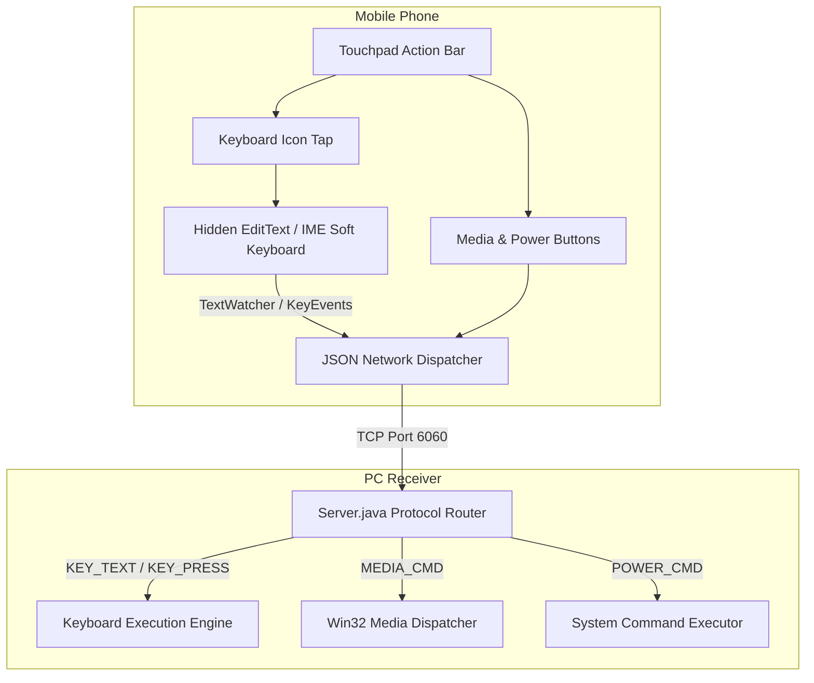

# CTRLX Feature Implementation Plan: Soft Keyboard, Media Controls & Power Actions

This plan details the design, protocol, and architecture for adding **Phone Soft Keyboard (IME) Typing**, **Media Controls**, and **PC Power Management Actions** to CTRLX.

---

## 1. Feature Breakdown & Architecture



---

## 2. Feature 1: Monect-Style Soft Keyboard (Phone IME)

### UX Flow (Identical to Monect)
1. On the Touchpad screen, a **Keyboard (`⌨️`)** button is placed on the top bar.
2. Tapping it focuses a transparent/hidden `EditText` and requests `InputMethodManager.showSoftInput()`.
3. The phone's native keyboard (Gboard, Samsung Keyboard, SwiftKey) slides up over the bottom part of the screen while keeping the touchpad surface active above it.
4. Voice-to-Text (mic icon on Gboard), autocomplete, emoji, and backspace all work seamlessly.
5. Tapping outside or the down-arrow hides the keyboard.

### Mobile Client Implementation
- **Layout**: Invisible helper `EditText` in [`activity_main.xml`](file:///e:/Sem-5-packages/ctrlx/mobile-client/app/src/main/res/layout/activity_main.xml):
  ```xml
  <EditText
      android:id="@+id/hiddenKeyInput"
      android:layout_width="1dp"
      android:layout_height="1dp"
      android:background="@android:color/transparent"
      android:inputType="textMultiLine|textNoSuggestions"
      android:imeOptions="flagNoExtractUi|actionSend"
      android:alpha="0" />
  ```
- **TextWatcher & KeyListener**:
  - Intercepts character commits $\rightarrow$ sends `{"type":"KEY_TEXT","text":"..."}`.
  - Intercepts `KeyEvent.KEYCODE_DEL` $\rightarrow$ sends `{"type":"KEY_PRESS","key":"BACKSPACE"}`.
  - Intercepts `KeyEvent.KEYCODE_ENTER` $\rightarrow$ sends `{"type":"KEY_PRESS","key":"ENTER"}`.

### PC Server Execution
- Already supported in [`Server.java`](file:///e:/Sem-5-packages/ctrlx/network-server/src/main/java/com/ctrlx/server/Server.java) and [`MouseController.java`](file:///e:/Sem-5-packages/ctrlx/network-server/src/main/java/com/ctrlx/server/MouseController.java):
  - Uses Windows clipboard insertion + `Ctrl+V` for multi-character strings/unicode.
  - Uses `Robot.keyPress` for individual control keys (`BACKSPACE`, `ENTER`, `TAB`, `ESC`).

---

## 3. Feature 2: Media Keys (Volume & Playback)

### Key Actions
- **Volume**: `VOL_UP`, `VOL_DOWN`, `MUTE`
- **Playback**: `PLAY_PAUSE`, `NEXT_TRACK`, `PREV_TRACK`, `STOP`

### Protocol Payload
```json
{
  "type": "MEDIA_COMMAND",
  "command": "VOL_UP"
}
```

### PC Server Execution (Windows Native)
Java's standard `java.awt.Robot` has limited support for multimedia virtual keys. We will execute them via Windows `user32.dll` `keybd_event` (available directly in our C# bridge or via lightweight Windows shell commands):
- `VK_VOLUME_MUTE (0xAD)`
- `VK_VOLUME_DOWN (0xAE)`
- `VK_VOLUME_UP (0xAF)`
- `VK_MEDIA_NEXT_TRACK (0xB0)`
- `VK_MEDIA_PREV_TRACK (0xB1)`
- `VK_MEDIA_STOP (0xB2)`
- `VK_MEDIA_PLAY_PAUSE (0xB3)`

---

## 4. Feature 3: Power & System Actions (Shutdown, Restart, Sleep, Lock)

### Actions Supported
| Action | Windows Command | Behavior |
| :--- | :--- | :--- |
| **Lock PC** | `rundll32.exe user32.dll,LockWorkStation` | Locks Windows instantly |
| **Sleep** | `rundll32.exe powrprof.dll,SetSuspendState 0,1,0` | Puts PC to low-power sleep |
| **Restart** | `shutdown.exe /r /t 0` | Reboots Windows |
| **Shutdown** | `shutdown.exe /s /t 0` | Powers down Windows safely |

### Safety & UX Protection
- To prevent accidental triggers during games or navigation:
  - Destructive actions (**Shutdown** and **Restart**) require a **Confirmation Dialog** on the phone:
    > *"Are you sure you want to shut down [PC Name]?"*  
    > `[ Cancel ]`  `[ Shut Down ]`
  - **Lock** and **Sleep** execute with single tap.

---

## 5. UI Integration in Mobile Client

1. **Touchpad Screen Header Bar**:
   - Add `[ ⌨️ Keyboard ]` toggle button.
   - Add `[ ⚡ Power ]` icon that opens a sleek bottom-sheet modal.
2. **Compact Media Controls Bar**:
   - Placed either directly above the left/right click buttons or in an expandable drawer:
     - `[ ⏮ ]`  `[ ⏯ ]`  `[ ⏭ ]`  `[ 🔉- ]`  `[ 🔊+ ]`  `[ 🔇 ]`
3. **Power Actions Bottom Sheet**:
   - Modern glassmorphism card with 4 quick tiles:
     - 🔒 Lock
     - 🌙 Sleep
     - 🔄 Restart
     - ⏻ Shut Down

---

## 6. Implementation Stages (When Ready)

1. **Phase 1: Backend Protocol Handlers**
   - Add `MEDIA_COMMAND` and `POWER_COMMAND` to [`Server.java`](file:///e:/Sem-5-packages/ctrlx/network-server/src/main/java/com/ctrlx/server/Server.java).
   - Add media key support to [`gamepad-bridge`](file:///e:/Sem-5-packages/ctrlx/gamepad-bridge/Program.cs) or native Windows invoker.
2. **Phase 2: Mobile IME Keyboard Integration**
   - Add hidden input and keyboard toggle in [`MainActivity.java`](file:///e:/Sem-5-packages/ctrlx/mobile-client/app/src/main/java/com/ctrlx/mobile/MainActivity.java).
   - Test live character typing, backspace, and phone speech-to-text.
3. **Phase 3: Media & Power UI**
   - Design modern pill controls for volume/playback.
   - Add the power menu bottom sheet with confirmation modals.
